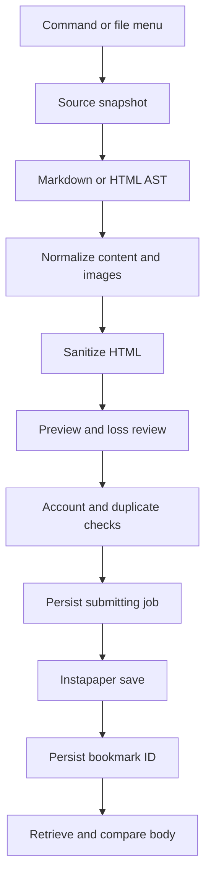

# Architecture

Updated 2026-10-24. This describes the implemented development build rather than the original proposed class layout.

## Processing pipeline



| Module | Responsibility |
| --- | --- |
| `src/main.ts` | Obsidian lifecycle, file access, settings, preview, export, and history UI |
| `src/types.ts` | Shared article, source, settings, and journal types |
| `src/converter.ts` | AST conversion, normalization, loss reporting, and HTML sanitization |
| `src/images.ts` | Image signatures, URL rules, data URIs, SVG filtering, and hashing |
| `src/credentials.ts` | Explicit credential-source selection and token validation |
| `src/client.ts` | Instapaper endpoint methods and safe error messages |
| `src/workflow.ts` | Single-process coordination, durable journal, and reconciliation |
| `src/verification.ts` | Body checkpoints and image-reference comparison |
| `src/template.ts` | Standalone reading HTML |

The code uses several focused modules in a flat `src` directory. Larger UI or platform additions should be extracted into folders when they improve reviewability; the current layout is intentionally small.

## Runtime and dependencies

TypeScript is bundled with esbuild as CommonJS. Obsidian, Electron, and `node:*` modules are external. The manifest declares `isDesktopOnly: true` and `minAppVersion: 1.11.4`, the minimum selected for SecretStorage and SecretComponent.

Dependencies are pinned in `package.json` and `package-lock.json`. The converter uses unified, remark, rehype, and YAML parsing. It does not invoke Obsidian MarkdownRenderer, other plugins' postprocessors, a shell, or an LLM to render source documents.

## Source and filesystem boundary

A source contains a path, text, and format. The active Markdown buffer takes precedence over the disk copy when it corresponds to the selected file. Other input is read through the Vault API. Before sending, the source text must still match the captured value.

Local image resolution uses Obsidian metadata and vault paths. Filesystem `realpath` checks compare the vault root and resolved target to reject symlinks outside the vault. This is a desktop containment check, not a promise of protection against a concurrent filesystem attacker changing a symlink after validation.

Input text is limited to 5 MiB. Each image is limited to 8 MiB and final article HTML to 24 MiB. AST inspection has node/depth budgets, but those run after parsing; they are not a complete parser memory or execution-time bound.

## Conversion and preview

Markdown becomes an HTML AST, with explicit handling for wiki links, callouts, tables, and footnotes. Frontmatter is recognized at the beginning of a document and parsed without allowing YAML alias expansion. Code nodes are not rewritten as wiki links.

HTML is parsed into an AST without executing its scripts or loading its assets. A unique article or main candidate may supply the body; otherwise the body is retained. Unsupported structures produce warnings before the allow-list sanitizer removes them.

The image policy permits validated raster data URIs and public HTTPS image references. JavaScript, filesystem, application, blob, and arbitrary data URLs are not accepted as image sources. Local SVG is reduced to a restricted subset and rasterized using a temporary browser image and canvas; object URLs are revoked afterward.

The preview passes article HTML through `cleanHtml(..., true)`, which replaces remote images and disables links, then through Obsidian's `sanitizeHTMLToDom`. The resulting fragment is appended with DOM APIs. Source HTML is never assigned directly through `innerHTML`. Preservation of embedded images through Obsidian's additional sanitizer still requires an in-app check.

The export template has its own reading styles and a restrictive CSP. Its appearance is intentionally independent of Obsidian's theme. Plugin interface styling uses scoped classes and Obsidian CSS variables.

## Credentials

Settings persist only `secretId`, `credentialSource`, and `envVarName`, alongside ordinary preferences and account/destination IDs. Token values remain in runtime memory and the Authorization header.

- `secret-storage`: read the selected entry through `this.app.secretStorage`.
- `environment`: read the configured name from `node:process.env` at client creation.
- Existing settings without a source continue using secret storage.
- Invalid variable names, missing values, and control characters are rejected without printing the token.
- An environment lookup never falls back to secret storage.

The plugin does not parse `.env`, run a shell profile, or invoke the optional launcher. The launcher is a user-run convenience for macOS process inheritance. Environment variables are not encrypted storage.

## API transport

All constructed requests target `https://www.instapaper.com/api/2` using Obsidian `requestUrl`.

| Method and path | Purpose |
| --- | --- |
| `GET /me` | Validate account and read subscription state |
| `GET /folders` | Select and revalidate an existing private destination |
| `POST /bookmarks` | Save the prepared HTML article |
| `GET /bookmarks` | Search a bounded interval for the job recovery marker |
| `GET /bookmarks/{id}/parse` | Retrieve the stored body for comparison |

A save supplies `title`, `private_source: "Obsidian"`, `content`, a description with a random `[s2r:...]` marker, and optionally `folder_id`. It does not invent a URL. `private_source` is an attribution label, not an access-control or idempotency guarantee.

The API client maps errors to controlled messages instead of exposing raw response bodies or transport errors. Requests use a fixed initial host, but cross-host redirect behavior belongs to Obsidian's transport and has not been separately validated. Do not claim an independently enforced redirect policy.

GET requests have a 20-second UI timeout and the save workflow has a 45-second timeout. There is no automatic HTTP retry loop. A timeout does not abort the underlying `requestUrl` operation.

## Journal and duplicate prevention

Plugin data has schema `1`, settings, and a jobs array. A job stores its random ID, account ID, source path, article title, SHA-256 hash, start timestamp, status, optional bookmark ID, and status notes. Complete source or article bodies and tokens are not persisted.

The fingerprint covers the converter version, final title, and final HTML. Account and path select the relevant journal entries. Destination is not part of the fingerprint. The journal uses serialized `saveData` writes and must persist a submitting entry before issuing a save request.

Startup converts outstanding `submitting` entries to `unknown`. Invalid journal structure stops loading without overwriting the invalid data. Existing settings receive the credential defaults; there is no general migration framework for arbitrary future schemas.

The in-process coordinator blocks concurrent send/reconcile operations. It is not a distributed lock, and the journal may itself be synchronized by the user's vault tooling.

## States and reconciliation

```text
submitting -> saved -> verified
     |          +--> warning
     +--> failed
     +--> unknown -> reconcile -> saved/warning
```

A definitive client error may become `failed`; network ambiguity becomes `unknown`. An ID is retained even if body retrieval fails. A late save response can resolve an unknown job without another POST.

Reconciliation requires the original account. It searches at most 20 pages of up to 100 changes, starting shortly before the recorded send time, and looks for the exact random marker. Exactly one match supplies the saved ID. No match or multiple matches leaves the result unresolved; absence from a bounded search is not proof that saving failed.

After restart, the original prepared article is unavailable. Reconciliation can retrieve a body but cannot certify a complete comparison against the old snapshot. It reports that limitation explicitly.

## Verification limits

Comparison normalizes text for matching without altering the uploaded article. It checks content checkpoints and actual image references in the retrieved body. An API-side image list alone does not count as successful image preservation.

A preserved URL does not prove successful downloading, decoded display, caching, or offline retention. Rewritten image URLs can also produce a warning even if the resulting image is visually correct. Human checks in the target reader remain necessary.
